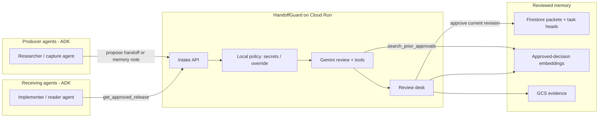

# HandoffGuard Revamp Guide

**Audience:** a coding agent working in a checkout of [HandoffGuard](https://github.com/mahekara28/HandoffGuard).  
**Baseline reviewed:** commit `6f7f3910f587d1a0a44259eb48c57cd2443c6081` (27 Nov 2026, 15:10 Asia/Calcutta), message *Update HandoffGuard implementation*.  
**Companion reference (read, do not clone into this product):** [gemini-shared-agent-memory-workshop](https://github.com/shivaylamba/gemini-shared-agent-memory-workshop) at `5ae2471` (27 Nov 2026, 20:42 Asia/Calcutta).  
**This brief was written 28 Nov 2026.** Re-check model IDs and SDK parameter names against official docs if you implement later.

Do the work in phases, in order. Phase 0 is mandatory before any public Cloud Run URL. Keep the existing unittest suite green after every phase; it is one of the strongest parts of the repo. Do not rewrite the product from scratch.

API and CLI names below were checked against official Google docs on 28 Nov 2026. Anything not fully confirmed is marked **UNVERIFIED** in [section 15](#15-unverified--verify-at-implement-time).

---

## How to use this brief

1. Read [section 2](#2-problem-statement) and [section 3](#3-what-to-keep-as-is) before editing.
2. Complete Phase 0, then 1–4. Phase 5 is stretch only.
3. After each phase: run `python -m unittest -v test_workflow` (and any new tests you add). Do not move on with a red suite.
4. Cite existing behavior from this tree only. If a file or line is not listed here, open the file and confirm before changing it.
5. Prefer small, reviewable commits per phase (`phase-0-auth`, `phase-1-demo-deploy`, …).

---

## 1. Context and goal

HandoffGuard is an early Gemini hackathon project. Today it is a Starlette review desk (launcher in `app.py`, server in `server.py`, policy in `review.py`, SQLite/Firestore in `storage.py`, static desk in `static/`). A reviewer pastes a source instruction and an outgoing handoff. Local regexes block obvious secrets and “ignore previous instructions” text. Otherwise one raw `urllib` `generateContent` call asks Gemini for cited findings; quotes are substring-checked against the transcripts; the worst finding is scored 0–4; a human (or `HANDOFF_AUTO_RELEASE=1`) approves; only an approved current revision is released to a receiving agent.

That core is real and worth keeping. For a hackathon it still reads as “two text boxes and one Gemini call.” The winning revamp is to make HandoffGuard the **reviewed control plane** between agents: Gemini checks a proposed handoff (and, later, a proposed memory write) against the source of truth **and prior approved decisions**, a human releases only a current revision, and the receiving agent can fetch only that release.

The reference workshop shows the bar for demo, evaluation, and shared knowledge: a capture → human review → reuse loop, a 2-minute demo script, and measured evals. It is a local workshop (no Cloud Run/Dockerfile/Firestore in that repo). Do not copy OpenLore or the ShopFlow app into HandoffGuard. Steal the *idea* (reviewed, portable, retrievable decisions) and the *demo discipline*.

---

## 2. Problem statement

**Recommended (statement B):**

> Agents now write instructions and memory that outlive a single session, and one bad or stale write poisons every agent that reads it later. HandoffGuard is the review layer for agent handoffs and shared memory. Before anything becomes memory, Gemini checks it against the source of truth and earlier approved decisions, quoting its evidence. Only approved, current revisions reach the agents that act on them.

**One-line pitch:** *HandoffGuard is the approval gate for multi-agent handoffs and shared memory — nothing ships to the next agent until Gemini has cited its evidence and a reviewer has released the current revision.*

Why this, not a thinner “instruction-integrity checker”: the desk already has quoted findings, revision/supersede, and a release gate. Shared memory is what the workshop leaves as a manual `lore:review` step, and it is the natural reason to use embeddings, Firestore, ADK, and Cloud Run together. A narrower “did the handoff keep the original instruction?” demo is a fallback if time runs out after Phase 1, but judges can still see that as a wrapper around one model call.

---

## 3. What to keep as-is

Do not regress or rewrite these. They are the product’s actual strengths.

| Behavior | Where | Why it stays |
|---|---|---|
| Substring citation check | `review.py` 99–102: each `source_quote` / `handoff_quote` must be a nonempty string, ≤1600 chars, and `citation not in original` fails the review | Prevents invented evidence. Covered by `test_retry_after_bad_citation` and `test_transcript_review_surfaces_worst_finding`. |
| Worst-finding ranking | `review.py` 104–105, `RISK` at 30–32 | A conflict outranks an aligned secondary finding. Do not auto-release on a mixed result (`test_transcript_review_surfaces_worst_finding` already asserts this). |
| Task lineage, `revises`, supersede | `storage.py` `claim()` 77–99; stale edit → `StaleRevision` / HTTP 409 | “A newer revision exists” is the release-safety story. `test_parallel_revisions_and_replayed_packet` and `test_slow_result_cannot_restore_old_revision` must keep passing. |
| Release gate | `review.py` `released()` 204–209, `needs_fresh_review()` 200–201 | Only `state == "approved"` and a current revision are releasable. Archived / superseded / pending stay held. |
| Policy before the model and before GCS | `review.py` 135–136, 160–165, 177–181; `test_policy_block_precedes_model_and_storage` | Secrets and override attempts never reach Gemini or `archive_evidence`. |
| `suspicious` cannot be auto-released or human-approved into a release without a new review | `review.py` 188–189; blocked packets reject `decision=approved` with 409 | Keep this even after SDK migration. |
| Offline self-test isolation | `release_check.py` uses a temp SQLite DB; `test_self_test_is_isolated_and_repeatable` | Tools → “Test release flow offline” must not mutate the real queue. |
| Receiver scoping | `server.py` `receive()` 107–117; Firebase role checks 157–162; `test_receiver_only_sees_assigned_current_release` | Assigned Firebase UID only, and only the current approved release. |
| Existing HTTP tests | `test_workflow.py` (16 tests, all passing on this commit against a mocked model) | Extend them. Do not replace them with a new framework mid-hackathon. |
| Dual storage backends | `storage.py` `Store`: SQLite if no `GOOGLE_CLOUD_PROJECT`, else Firestore collections `handoff_packets` / `handoff_tasks` | Local tests stay offline. New memory records need a SQLite fallback too. |

Provider selection already documented in the README and tested in `test_api_key_used_for_matching_text_with_vertex_also_set`: if `GEMINI_API_KEY` is set, use the Gemini Developer API even when a Vertex project is also set. Keep that rule when you swap the client.

---

## 4. Target architecture



Phase 5 can add Google Search grounding, Gemini Live API on the desk, Vertex Memory Bank after approval, and Pub/Sub or Cloud Tasks for async review. Those are not required to tell the story.

---

## 5. Google services mapping

| Feature | Service / API | When |
|---|---|---|
| Host the desk + API | Cloud Run (`PORT` already read in `app.py` 19; binds `0.0.0.0` when `K_SERVICE` is set, `app.py` 29–30) | Phase 1 |
| Container images | Artifact Registry + Cloud Build (`cloudbuild.yaml`) | Phase 1 |
| `GEMINI_API_KEY`, `HANDOFF_REVIEW_TOKEN` | Secret Manager, mounted into Cloud Run with `--set-secrets` | Phase 1 |
| Packet + task lineage | Firestore collections already used: `handoff_packets`, `handoff_tasks` (`storage.py` 24, 39) | Already present; used in Phase 1+ when `GOOGLE_CLOUD_PROJECT` is set |
| Evidence blobs | Cloud Storage via `HANDOFF_EVIDENCE_BUCKET` (`review.py` 177–181, `cloud_services.py` 9–17) | Optional, already present |
| Semantic review | Official `google-genai` SDK, `client.models.generate_content`, structured output | Phase 2 |
| Prior-approval retrieval | `client.models.embed_content` with `gemini-embedding-2`, Firestore `find_nearest` | Phase 3 |
| Multi-agent demo | `google-adk` (already in `requirements-adk.txt` and `adk_demo.py`) | Phase 1 |
| Auth for a public URL | Firebase Auth (already sketched) **or** `HANDOFF_REVIEW_TOKEN` on all `/api/*` except `/api/config` | Phase 0, then 1 |
| Eval / risk counts | Existing `risk_export.py` → BigQuery; live cases from `test_gemini_live.py` shown on the desk | Phase 4 |
| Request traces | Cloud Logging structured logs (and Cloud Trace if time) | Phase 4 |
| Stretch | Google Search grounding; Live API (`gemini-3.8-live`); Vertex Memory Bank / Agent Engine Sessions; Pub/Sub or Cloud Tasks | Phase 5 |

`firebase.json` already names the Cloud Run service `handoffguard` in `us-central1`. Use those values unless you have a reason not to.

---
## 6. Phase 0 — Security and hygiene (before any public URL)

**Goal:** Close the auth hole the README currently misstates, fix the small correctness bugs, and make the container/docs safe to deploy.

**Why judges / operators care:** A publicly invokable Cloud Run service on this commit lets anyone list packets, submit reviews (and burn the Gemini key), run `/api/gemini-demo` (two live billed calls), and read approved handoff text. The README says `GEMINI_API_KEY` + `HANDOFF_REVIEW_TOKEN` is enough for a “private IAM deployment.” That is not true today. Fix this before you share a URL.

**Estimate:** 1.5–3 hours.

### 0.1 Auth on all `/api/*` except `/api/config`

**What is wrong today**

- Token check exists only on `POST /api/reviews/{key}/decision` (`server.py` 84–89).
- Firebase middleware (`server.py` `privacy()` 149–163) only runs when `HANDOFF_FIREBASE_PROJECT` is set, and already covers `/api/*` except `/api/config`. Keep that path.
- Without Firebase, `GET /api/reviews`, `POST /api/reviews`, `GET .../release`, `POST /api/self-test`, and `POST /api/gemini-demo` are open (`server.py` 71–77, 102–103, 120–126, 133–141).
- When `K_SERVICE` is set and no token and no Firebase, decisions already 403 (the `(token or os.getenv("K_SERVICE"))` clause). Intake and list do not.

**Exact change**

Introduce one helper, used by every `/api/*` route except `/api/config` (and the new `/healthz` in 0.6):

- If `HANDOFF_FIREBASE_PROJECT` is set: leave `privacy()` as the auth layer (do not also require the static review token).
- Else if `HANDOFF_REVIEW_TOKEN` is set **or** `K_SERVICE` is set: require `X-Review-Token` (same `hmac.compare_digest` pattern as 86–89). If `K_SERVICE` is set and the token env is missing, fail closed (403), same as decisions do today.
- Else (local laptop, no token, no Cloud Run): keep today’s open local desk, still bound to `127.0.0.1` (`app.py` 29) and `TrustedHostMiddleware` (`server.py` 144–145).

Gate `/api/self-test` and `/api/gemini-demo` the same way. Optionally also require `HANDOFF_ENABLE_DEMOS=1` in production (`K_SERVICE` set) so a leaked token cannot be used only to burn quota; not required if the token is already mandatory.

**UI:** `config.protected` is already `not firebase and bool(token or K_SERVICE)` (`server.py` 64). `desk.js` currently sends `X-Review-Token` only on decisions (193–197). After this change, **every** `api()` call in protected mode must send the token, and the token field must be visible before the queue loads (mirror the Firebase `loginView` flow). Otherwise `refresh()` will 403 in a loop.

**Test to add:** with `HANDOFF_REVIEW_TOKEN=review-test` and `HANDOFF_FIREBASE_PROJECT=""` (already the `Workflow` fixture in `test_workflow.py` 36–39), unauthenticated `GET /api/reviews`, `POST /api/reviews`, `GET /api/reviews/{id}/release`, `POST /api/gemini-demo`, and `POST /api/self-test` return 403 (or 401). Authenticated calls with the correct token still succeed.

**Sharp pointer — existing tests will break** until you update `Workflow.call()` (`test_workflow.py` 60–72). Today only `reviewer=True` attaches `X-Review-Token`. After 0.1, almost every API call in the suite needs the token. Change `call()` to send the token by default, and add an `anonymous=True` (or similar) flag for the new rejection test. Do not sprinkle `reviewer=True` across 16 tests by hand.

### 0.2 Close the generic release leak

**What is wrong:** unauthenticated (or any token-holder, once 0.1 lands) `GET /api/reviews` returns `id` values (`server.py` 76–77). `GET /api/reviews/{key}/release` then returns `{id, revision, handoff}` (`review.py` 204–209, routed at `server.py` 102–103) with no receiver check.

**Exact change:**

- Keep `/api/receiver/{key}/release` as the only unattended agent path (already requires a Firebase receiver UID, `server.py` 107–117).
- `GET /api/reviews/{key}/release` may remain for the desk / trusted local demo, but only for an authenticated reviewer or member (Firebase) or a valid review token (protected mode). It must not be reachable anonymously once a token or Firebase is configured.
- `public()` already strips `owner` (`server.py` 24–25). Do not put `handoff` on the list endpoint. The list payload should stay the summary fields already returned (id, reference, revision, state, updated).

**Test to add:** anonymous (or non-reviewer / wrong UID) cannot read `handoff` from `/api/reviews/{id}/release`. Extend, do not weaken, `test_receiver_only_sees_assigned_current_release`.

### 0.3 Secret regex: add modern Google AI Studio keys

**Where:** `review.py` 19.

Today the pattern matches `AIza…`, PEM private keys, `gh[pousr]_…`, and labeled `api_key` / `password` / `access_token`. The reference workshop docs state that **new** AI Studio keys start with `AQ.` and that `AIza…` keys are being phased out. An `AQ.` key in a transcript is not blocked unless it also matches the labeled pattern.

**Exact change:** add an `AQ.` alternative alongside `AIza…`. Keep the existing alternatives. Do not log or persist the matched secret (blocked packets already blank `source` / `handoff` and rewrite the reference to `"Restricted packet"`, `review.py` 144–145 — keep that).

Suggested addition (keep the rest of the existing alternation intact):

```python
# Add this alternative next to the existing AIza[0-9A-Za-z_-]{35} branch:
#   AQ\.[A-Za-z0-9_-]{20,}
```

**Test to add:** a handoff containing an `AQ.`-shaped key, with `review.analyze` patched to raise if called, ends in `state == "blocked"`, the secret does not appear in the JSON response or the SQLite file (same assertions as `test_policy_block_precedes_model_and_storage`, lines 112–120). Keep the existing `api_key=DEMO_ONLY_VALUE` case passing.

### 0.4 Trim Firebase allowlists

**Where:** `server.py` 157–158:

```python
reviewers = os.getenv("HANDOFF_FIREBASE_REVIEWERS", "").split(",")
members = os.getenv("HANDOFF_FIREBASE_MEMBERS", "").split(",")
```

`"reviewer, uid2"` will not match `uid2`. Empty string splits to `['']`.

**Exact change:**

```python
reviewers = [u.strip() for u in os.getenv("HANDOFF_FIREBASE_REVIEWERS", "").split(",") if u.strip()]
members = [u.strip() for u in os.getenv("HANDOFF_FIREBASE_MEMBERS", "").split(",") if u.strip()]
```

**Test to add:** with `HANDOFF_FIREBASE_REVIEWERS=" reviewer "`, a Firebase user whose `sub` is `reviewer` can `POST` a decision (extend `test_firebase_reviewer_role`).

### 0.5 Guard `claim()` when the task head is dangling

**Where:** `storage.py` 90–94. If `tasks` points at `current` but that packet row is missing, `prior.update(...)` raises.

**Exact change:** only supersede when `prior` is a dict. If `prior is None`, skip the mutate and still write the new task head + packet (or raise a clear `Problem` — skipping a missing prior is enough so intake cannot 500).

**Test to add:** seed a `tasks` row whose `id` does not exist in `packets`, then `submit` a new revision for that reference; the call returns 200 and a current packet, not a 500.

### 0.6 Health endpoint, non-root Dockerfile, probes

**Dockerfile today** (`Dockerfile` 1–7): `FROM python:3.12-slim`, copies `requirements.txt` then the Python modules and `static/`, `CMD ["python", "app.py"]`, runs as root, no health check. `.dockerignore` already excludes `.env*`, venv, sqlite, credentials, `.git`.

**App change:** add `GET /healthz` (and register it in `server.py` routes) that returns 200 `{"ok": true}` **without** requiring the review token or Firebase. Cloud Run probes must be able to hit it.

**Dockerfile change (proposed):**

```dockerfile
FROM python:3.12-slim
WORKDIR /app
COPY requirements.txt .
RUN pip install --no-cache-dir -r requirements.txt
COPY app.py server.py review.py release_check.py storage.py cloud_services.py ./
COPY static/ ./static/
RUN useradd --system --uid 10001 --create-home appuser \
    && chown -R appuser:appuser /app
USER 10001
ENV HANDOFF_DB=/tmp/reviews.sqlite
CMD ["python", "app.py"]
```

Sharp pointers:

- On Cloud Run, `GOOGLE_CLOUD_PROJECT` will select Firestore (`storage.py` 22–24), so the container should not need a writable `/app`. For local `docker run` without that env, SQLite must live somewhere writable by uid 10001 (`/tmp` is fine).
- **Cloud Run does not honor `HEALTHCHECK` in the Dockerfile.** Configure service probes (official flags, [Configure container health checks](https://cloud.google.com/run/docs/configuring/healthchecks)):

```bash
gcloud run deploy handoffguard \
  --startup-probe=httpGet.path=/healthz,httpGet.port=8080,periodSeconds=10,failureThreshold=12,timeoutSeconds=3 \
  --liveness-probe=httpGet.path=/healthz,httpGet.port=8080,periodSeconds=30,failureThreshold=3,timeoutSeconds=3
```

Cloud Run injects `PORT` (already used). 8080 is the default; if you set a different `--port`, use that in the probe. A Dockerfile `HEALTHCHECK` is optional local hygiene only.

- Do not copy `adk_demo.py`, tests, or keys into the image (the current `COPY` list is already tight — keep it that way).

**Test to add:** `GET /healthz` returns 200 with no token.

### 0.7 Remove the Streamlit stub

**Where:** `app.py` 6–11 (if `"streamlit" in sys.modules`, show a “start the real server” page). `.streamlit/config.toml` is a leftover theme. The desk is the static app on 8502, not Streamlit.

**Exact change:** delete the Streamlit branch; `app.py` should only parse args and run uvicorn. Delete `.streamlit/config.toml`. You can drop `.streamlit/secrets.toml` from `.gitignore` if you want; harmless if left.

### 0.8 LICENSE and packaging

There is no `LICENSE`, no `pyproject.toml`, no `setup.py` in this commit. `requirements.txt` pins `starlette==1.10.0`, `uvicorn==0.54.0`, and ranges for Firestore/Storage.

**Exact change:**

- Add a `LICENSE`. Default to MIT unless the repo owner has already chosen otherwise.
- Optional but useful: a minimal `pyproject.toml` with `requires-python = ">=3.11"` (README already says 3.11+) and the same dependencies. It is fine to keep `requirements.txt` as the install path CI already uses (`.github/workflows/test.yml` 14).
- Do not add a package rename or src-layout mid-hackathon.

### Phase 0 files to touch

- `server.py`, `static/desk.js`, `static/index.html` (token field visibility)
- `review.py` (regex only)
- `storage.py` (`claim` guard)
- `app.py`, `.streamlit/config.toml`
- `Dockerfile`
- `test_workflow.py` (default token + new cases)
- `LICENSE`, optional `pyproject.toml`

### Phase 0 acceptance

- [ ] Unauthenticated API access is rejected whenever `HANDOFF_REVIEW_TOKEN` or `K_SERVICE` or Firebase is configured, including list, intake, release, and demos.
- [ ] `/healthz` is public and 200.
- [ ] `AQ.` keys are blocked locally; `analyze` is not called.
- [ ] Firebase allowlists trim whitespace.
- [ ] Dangling task heads do not 500.
- [ ] Image is non-root; SQLite path is writable if used.
- [ ] Streamlit stub is gone.
- [ ] `python -m unittest -v test_workflow` is green, including new tests.

### Phase 0 pitfalls

- Forgetting to update `desk.js` `api()` will make a protected Cloud Run desk look “broken” (queue never loads).
- Forgetting to default the token in `Workflow.call()` will fail most of the existing 16 tests at once.
- Do not require a token on `/` or `/static/*` or `/healthz`.
- `hmac.compare_digest` still needs two `bytes` of the token; keep the existing encode pattern.

---
## 7. Phase 1 — Demo flow with ADK, then Cloud Run deploy

**Goal:** One scripted, judge-ready path: researcher proposes a conflicting handoff → desk shows a cited conflict → reject → corrected revision approved → implementer can only read the approved release. The same server is deployed to Cloud Run with credentials stored in Secret Manager.

**Why judges care:** This is the moment they understand the product. The workshop’s `docs/DEMO_SCRIPT.md` is the quality bar: timed steps, what to say, what not to say, and a fallback. `adk_demo.py` today is a side script (`InMemoryRunner`, not in the Docker image, separate `requirements-adk.txt`). Make that path reliable and documented, then put a URL on a slide.

**Estimate:** 3–5 hours (demo script + ADK polish first, deploy second).

### 1.1 Script the ADK walkthrough

**Existing pieces**

- `adk_demo.py`: researcher agent writes a one-sentence handoff from “Keep the deprecated API alias…”. `--change` replaces it with `"Remove the deprecated API alias."`. Submits via `agent_api.intake_packet`, prints “Open the desk…”, then `wait_for_release` polls until approved, then an implementer agent plans against the released text.
- `agent_api.py`: `HANDOFF_URL` default `http://127.0.0.1:8502`, optional Firebase tokens, 120 × 2s poll, treats only `Release held: pending` / `Release held: checking` as waitable 409s.
- After Phase 0, local unauthenticated intake still works on localhost. Against Cloud Run, the client must send `X-Review-Token` or a Firebase bearer. **`agent_api.request()` today only adds `Authorization: Bearer` when `token=` is set — it does not send `X-Review-Token`.** Add optional `HANDOFF_REVIEW_TOKEN` support or you cannot run the demo against a protected Cloud Run URL.

**Tasks**

- [ ] Add `X-Review-Token` support in `agent_api.py` from env `HANDOFF_REVIEW_TOKEN`.
- [ ] Keep `--change` as the contradiction path. Print the packet id, the desk URL, and a one-line “what the reviewer should see.”
- [ ] Add a second documented command (or a flag) for the **correction** revision: same `reference`, `revises=<id>`, handoff restored to a keep-the-alias wording. The implementer should still be blocked until that revision is approved.
- [ ] Do not put ADK into the Cloud Run image unless you also want to host the agents there (not required). Run ADK demos from a laptop or a separate venv with `requirements-adk.txt` (`google-adk>=1.17,<2`).
- [ ] Write `docs/DEMO_SCRIPT.md` (see [section 12](#12-demo-script-outline-2-3-minutes) for the outline). Include a no-ADK fallback: Tools → Run Gemini demo, or paste the built-in “Deprecated API alias” / “Changed instruction” examples already served by `/api/config` (`server.py` 65–68, `ALIAS_SOURCE` / `ALIAS_HANDOFF` in `review.py` 34–35).

**Acceptance:** a newcomer can run the desk, run the ADK (or fallback) flow, and finish the story in under three minutes. `test_live_demo_*` and `test_self_test_*` still pass.

### 1.2 Deploy to Cloud Run (Secret Manager, Cloud Build, Artifact Registry)

Official command and flag names below are from Cloud Run, Secret Manager, Artifact Registry, and Cloud Build docs (checked 28 Nov 2026).

**Tasks**

- [ ] Add a short `docs/DEPLOY.md` (or a “Cloud Run” section in the README) with the commands, not a verbal README-only note.
- [ ] Add `cloudbuild.yaml` that builds, pushes to Artifact Registry, and deploys. Official builder images and `gcloud run deploy` step are documented in [Build and deploy to Cloud Run](https://cloud.google.com/build/docs/deploying-builds/deploy-cloud-run).
- [ ] Use a dedicated runtime service account (not the default Compute SA if you can avoid it). Grant only what you use.

**One-time project setup** (replace `PROJECT_ID`; region `us-central1` matches `firebase.json`):

```bash
gcloud config set project PROJECT_ID
gcloud config set run/region us-central1

gcloud services enable \
  run.googleapis.com \
  artifactregistry.googleapis.com \
  cloudbuild.googleapis.com \
  secretmanager.googleapis.com \
  firestore.googleapis.com \
  storage.googleapis.com

# Only if you will call Vertex / Gemini Enterprise Agent Platform instead of an AI Studio key:
# gcloud services enable aiplatform.googleapis.com

gcloud artifacts repositories create handoffguard \
  --repository-format=docker \
  --location=us-central1 \
  --description="HandoffGuard images"

gcloud auth configure-docker us-central1-docker.pkg.dev

# Secrets: official pattern is --data-file=- for stdin (no trailing newline).
# Do not put credentials in the repo, Dockerfile, or --set-env-vars.
printf '%s' 'YOUR_GEMINI_API_KEY' | gcloud secrets create gemini-api-key --data-file=-
printf '%s' 'YOUR_REVIEW_TOKEN'   | gcloud secrets create handoff-review-token --data-file=-

gcloud iam service-accounts create handoffguard \
  --display-name="HandoffGuard Cloud Run"

SA="handoffguard@PROJECT_ID.iam.gserviceaccount.com"

gcloud secrets add-iam-policy-binding gemini-api-key \
  --member="serviceAccount:${SA}" \
  --role="roles/secretmanager.secretAccessor"
gcloud secrets add-iam-policy-binding handoff-review-token \
  --member="serviceAccount:${SA}" \
  --role="roles/secretmanager.secretAccessor"

# Firestore access when GOOGLE_CLOUD_PROJECT is set on the service:
gcloud projects add-iam-policy-binding PROJECT_ID \
  --member="serviceAccount:${SA}" \
  --role="roles/datastore.user"
```

`roles/datastore.user` is the usual project role for Firestore in Native mode. If you enable a private evidence bucket, grant `roles/storage.objectAdmin` on **that bucket**, not the whole project.

**Source deploy (fast path, official):** `gcloud run deploy --source .` uses the Dockerfile if present and Cloud Build under the hood ([Deploy from source](https://cloud.google.com/run/docs/deploying-source-code)).

```bash
gcloud run deploy handoffguard \
  --source . \
  --region us-central1 \
  --service-account="${SA}" \
  --set-secrets=GEMINI_API_KEY=gemini-api-key:latest,HANDOFF_REVIEW_TOKEN=handoff-review-token:latest \
  --set-env-vars=GEMINI_MODEL=gemini-3.8-flash,GOOGLE_CLOUD_PROJECT=PROJECT_ID,HANDOFF_AUTO_RELEASE=0 \
  --allow-unauthenticated \
  --startup-probe=httpGet.path=/healthz,httpGet.port=8080,periodSeconds=10,failureThreshold=12,timeoutSeconds=3 \
  --liveness-probe=httpGet.path=/healthz,httpGet.port=8080,periodSeconds=30,failureThreshold=3,timeoutSeconds=3
```

**Why `--allow-unauthenticated`:** judges must load the HTML without a Google IAM account. **This is not “the API is open.”** Phase 0 is what protects `/api/*`. If you skip Phase 0 and use this flag, the Gemini credential will be abused. Alternative: `--no-allow-unauthenticated` plus IAP, which is safer and worse as a walk-up demo.

`--set-secrets=ENV=SECRET:VERSION` is the official Cloud Run form ([gcloud run deploy](https://docs.cloud.google.com/sdk/gcloud/reference/run/deploy)). Docs recommend pinning a numeric version for env-var secrets rather than `latest` if you need stable rollouts; `latest` is acceptable for a hackathon if you rotate carefully. The runtime SA must have `roles/secretmanager.secretAccessor` or the revision will not start.

**Explicit image path** (Artifact Registry form `LOCATION-docker.pkg.dev/PROJECT_ID/REPO/IMAGE:TAG`):

```bash
IMAGE="us-central1-docker.pkg.dev/PROJECT_ID/handoffguard/handoffguard:$(git rev-parse --short HEAD)"
gcloud builds submit --tag "${IMAGE}"
gcloud run deploy handoffguard \
  --image "${IMAGE}" \
  --region us-central1 \
  --service-account="${SA}" \
  --set-secrets=GEMINI_API_KEY=gemini-api-key:latest,HANDOFF_REVIEW_TOKEN=handoff-review-token:latest \
  --set-env-vars=GEMINI_MODEL=gemini-3.8-flash,GOOGLE_CLOUD_PROJECT=PROJECT_ID,HANDOFF_AUTO_RELEASE=0 \
  --allow-unauthenticated
```

**`cloudbuild.yaml` skeleton** (official step names from Cloud Build’s Cloud Run deploy doc). Substitutions you should parameterize rather than hard-code project IDs:

```yaml
steps:
  - name: gcr.io/cloud-builders/docker
    args: ['build', '-t', 'us-central1-docker.pkg.dev/$PROJECT_ID/handoffguard/handoffguard:$COMMIT_SHA', '.']
  - name: gcr.io/cloud-builders/docker
    args: ['push', 'us-central1-docker.pkg.dev/$PROJECT_ID/handoffguard/handoffguard:$COMMIT_SHA']
  - name: gcr.io/google.com/cloudsdktool/cloud-sdk
    entrypoint: gcloud
    args:
      - run
      - deploy
      - handoffguard
      - --image=us-central1-docker.pkg.dev/$PROJECT_ID/handoffguard/handoffguard:$COMMIT_SHA
      - --region=us-central1
      - --service-account=handoffguard@$PROJECT_ID.iam.gserviceaccount.com
      - --set-secrets=GEMINI_API_KEY=gemini-api-key:latest,HANDOFF_REVIEW_TOKEN=handoff-review-token:latest
      - --set-env-vars=GEMINI_MODEL=gemini-3.8-flash,GOOGLE_CLOUD_PROJECT=$PROJECT_ID,HANDOFF_AUTO_RELEASE=0
      - --allow-unauthenticated
images:
  - us-central1-docker.pkg.dev/$PROJECT_ID/handoffguard/handoffguard:$COMMIT_SHA
```

Submit with `gcloud builds submit --region=us-central1`. Cloud Build’s default SA needs permission to push to the Artifact Registry repo and to deploy Cloud Run (`roles/run.admin` and `roles/iam.serviceAccountUser` on the runtime SA — confirm in the current Cloud Build deploy doc if your project uses the newer per-project build SA).

**After deploy**

- [ ] `curl` `/healthz` → 200.
- [ ] `curl` `/api/reviews` with no token → 401/403.
- [ ] Open the desk, enter the review token, run the offline self-test (or a real submit if the model is configured).
- [ ] If you use Firebase Hosting rewrites, set `HANDOFF_PUBLIC_ORIGIN` to the Hosting origin (already consulted in `server.py` 37). `TrustedHostMiddleware` is already skipped when `K_SERVICE` is set (144–145).

### Phase 1 files to touch

- `agent_api.py`, `adk_demo.py`
- `docs/DEMO_SCRIPT.md`, `docs/DEPLOY.md` or README Cloud Run section
- `cloudbuild.yaml` (new)
- README (bash + PowerShell run instructions — today it is PowerShell-only)

### Phase 1 acceptance

- [ ] Documented 2–3 minute demo works locally.
- [ ] ADK (or fallback) path can talk to a token-protected server.
- [ ] Cloud Run revision is up, credentials live in Secret Manager rather than `--set-env-vars`, `/healthz` is 200, anonymous API is not.
- [ ] `HANDOFF_AUTO_RELEASE` stays `0` on the public demo unless you are deliberately showing auto-release in a controlled step.

### Phase 1 pitfalls

- Deploying before Phase 0 with `--allow-unauthenticated` is the failure mode this whole guide exists to prevent.
- Cloud Run request timeout default is 300s, so the current synchronous 40s Gemini call can survive a demo. Do not “fix” that with an in-process background thread that continues after the response — **by default Cloud Run allocates CPU only during request processing.** Async belongs in Phase 4 with Cloud Tasks/Pub/Sub.
- Firestore in a new project may need a one-time database create (`(default)`, Native mode) in the console or `gcloud firestore databases create`. Do that before setting `GOOGLE_CLOUD_PROJECT` on the service, or intake will fail.
- `firebase.json` expects service id `handoffguard` in `us-central1`. Renaming the service breaks Hosting rewrites.

---
## 8. Phase 2 — Official Gemini SDK, schema, retries, tools

**Goal:** Replace the raw `urllib` POST in `review.analyze()` with the official Google Gen AI SDK, structured output, retries, visible token/latency, and a pinned current default model. Add at least one function-calling tool (`search_prior_approvals` can stub until Phase 3).

**Why judges care:** this is the “we actually used Gemini, not a JSON HTTP call” moment. It also makes findings more reliable, which protects the citation check and the auto-release flag.

**Estimate:** 3–5 hours.

### 2.1 Migrate `analyze()` to `google-genai`

**Today** (`review.py` 52–109): builds a REST body with `systemInstruction`, one user part (`json.dumps({"source", "handoff"})`), `generationConfig.responseMimeType = application/json`. Vertex branch uses ADC and `https://aiplatform.googleapis.com/v1/projects/.../locations/global/publishers/google/models/{model}:generateContent`. Key branch uses `https://generativelanguage.googleapis.com/v1beta/models/{model}:generateContent` and `x-goog-api-key`. Timeout 40s. Parses `candidates[0].content.parts`, skips `thought` parts, `json.loads` the text, validates 1–20 findings, sorts by `RISK`. Failures become HTTP 502 / packet `failed`.

**SDK (official, [python-genai docs](https://googleapis.github.io/python-genai/), checked 28 Nov 2026):**

```python
from google import genai
from google.genai import types

# Gemini Developer API (keep preferring this when GEMINI_API_KEY is set):
client = genai.Client(api_key=os.environ["GEMINI_API_KEY"])

# Vertex / Gemini Enterprise Agent Platform (when no API key, project is configured).
# Current docs prefer enterprise=True and env GOOGLE_GENAI_USE_ENTERPRISE=true
# plus GOOGLE_CLOUD_PROJECT and GOOGLE_CLOUD_LOCATION.
# The same docs still show vertexai=True as an alias — do not set both to conflicting values.
client = genai.Client(enterprise=True, project=project, location=location)

response = client.models.generate_content(
    model=model,
    contents=...,  # keep source+handoff as untrusted JSON in the user turn
    config=types.GenerateContentConfig(
        system_instruction=instruction,  # reuse the existing prompt at review.py 56–65
        response_mime_type="application/json",
        response_json_schema=FINDINGS_SCHEMA,  # see 2.2
    ),
)
```

**Tasks**

- [ ] Add `google-genai` to `requirements.txt` (CI installs that file). Confirm the import is `from google import genai`. Do not use the legacy `google.generativeai` package.
- [ ] Keep the env policy: API key wins over Vertex (`review.py` 70, 131; README; existing test). Map `VERTEX_PROJECT` to the new client’s `project=` if you want backward compatibility, and document `GOOGLE_CLOUD_PROJECT` / `GOOGLE_CLOUD_LOCATION` as the SDK-native names.
- [ ] Default `GEMINI_MODEL` if unset: **`gemini-3.8-flash`**. This is the model string used throughout the current official SDK examples. Override via env. As of 28 Nov 2026 the AI Studio models page also lists a Gemini 4 family (`gemini-4-carbon`, `gemini-4-neon`, `gemini-4-hydrogen`, `gemini-4-argon`). Use those only if the project has access and a quick smoke call succeeds; do not hard-code Gemini 4 as the default without a fallback. Free-tier fallback used by the workshop: `gemini-3.5-flash-lite`.
- [ ] Keep skipping thought parts if the SDK still surfaces them; prefer `response.parsed` when using a schema. **Keep the substring citation loop unchanged.**
- [ ] Time the call and read `response.usage_metadata` (`prompt_token_count`, `candidates_token_count`, and `total_token_count` if present). Persist them on the packet (e.g. `usage`: `{latency_ms, input_tokens, output_tokens, model, provider}`) and show them on the desk near `#engine`.
- [ ] Retry **429 and 503** (and transient `OSError`) with exponential backoff, cap so the whole `analyze()` still fits in a Cloud Run request (stay under ~40–60s unless you raise the timeout deliberately). Official SDK retry helpers: **UNVERIFIED** — implement a small explicit retry loop unless you confirm an official `HttpOptions` retry API in the installed SDK version.
- [ ] Update `test_workflow` patches. Today many tests patch `review.urlopen`. After the migration they must patch `analyze` or the new client method (`client.models.generate_content` is harder to patch if the client is constructed inside the function — inject a client factory or patch a thin wrapper you own). `test_api_key_used_for_matching_text_with_vertex_also_set` must still prove the Developer API is selected when both key and project are set. Do not assert the old REST URL.

### 2.2 Structured output

Official SDK docs support both:

- `config={"response_mime_type": "application/json", "response_json_schema": <standard JSON Schema dict>}`
- `config=types.GenerateContentConfig(response_mime_type="application/json", response_schema=PydanticModel)`

An SDK maintainer has said `response_json_schema` is the long-term path. Either is acceptable. The schema must encode the current contract: a `findings` array of 1–20 objects with `status` ∈ `aligned|conflict|missing|unclear|off_task|suspicious`, `reason` (string), `source_quote`, `handoff_quote`. Do **not** let the model invent a `sensitive` status (that stays local policy). After parse, still run the existing Python validators and citation check — the schema is not a substitute.

Do not duplicate a full JSON example of the schema in the system prompt (official structured-output guidance).

### 2.3 Function calling tool

Official manual tool pattern ([python-genai docs](https://googleapis.github.io/python-genai/)):

```python
function = types.FunctionDeclaration(
    name="search_prior_approvals",
    description="Retrieve previously approved handoff decisions related to this task or instruction.",
    parameters_json_schema={
        "type": "object",
        "properties": {
            "query": {"type": "string", "description": "Natural-language query over approved decisions."}
        },
        "required": ["query"],
    },
)
tool = types.Tool(function_declarations=[function])
# response.function_calls -> execute -> types.Part.from_function_response(...)
# next generate_content contents: [user, function_call content, types.Content(role="tool", parts=[...])]
```

**Tasks**

- [ ] In Phase 2, the tool may return `[]` or a SQLite/Firestore lookup by `reference` only (no embeddings yet). Wire the loop so Phase 3 only has to fill the function body.
- [ ] **UNVERIFIED at implement time:** whether your pinned model allows `tools` and `response_json_schema` on the *same* request. If a call is rejected, do a tool-calling loop first, then a final structured-output call with no tools. Do not silently drop the schema.
- [ ] Cap tool rounds (e.g. 3) so a looping model cannot hang the request.
- [ ] Automatic function calling exists in the SDK; manual is easier to test. Prefer manual in this codebase so `test_workflow` can stub the tool.

### Phase 2 files to touch

- `review.py` (`analyze`, client factory, usage fields on the packet in `finish()`)
- `requirements.txt`
- `static/desk.js` / `static/index.html` (tokens + latency)
- `test_workflow.py`, optionally a unit test for schema validation / retry without booting uvicorn
- README “Connect Gemini” section (SDK, default model, env names)

### Phase 2 acceptance

- [ ] No `urllib.request` Gemini call remains in `analyze()`.
- [ ] Findings still fail the packet when a quote is not a substring.
- [ ] Desk shows model, provider (already in `engine`), plus tokens and latency for a completed review.
- [ ] 429/503 is retried; a permanent 4xx still becomes `failed` / 502-style Problem.
- [ ] Default model is env-overridable; unset default is a current official ID.
- [ ] Full `test_workflow` green.

### Phase 2 pitfalls

- Patching the wrong layer will silently mark the suite green without testing the new client.
- Thought parts, empty `candidates`, or safety blocks should remain a verified `Problem(502, ...)` — same as today’s `IndexError`/`KeyError` handler (107–109).
- Do not send the API key back in `public()` or logs. `test_api_key_used_for_matching_text_with_vertex_also_set` already asserts `"synthetic"` is not in the response body.
- Keep `offline=True` in `release_check.py` off the live client (it already uses `local_conflict` / exact-match fixtures).

---

## 9. Phase 3 — Shared memory (the winning wedge)

**Goal:** When a reviewer approves a packet, embed the decision with `gemini-embedding-2` and store it. Later reviews of related work retrieve those decisions and include them in the Gemini prompt (and in the `search_prior_approvals` tool). The desk can say: “this contradicts approved revision 1: keep the alias.”

**Why judges care:** this is the workshop’s capture → review → reuse loop, productized. It is the difference between a judge and a wrapper.

**Estimate:** 4–6 hours.

### 3.1 Embedding API and dimension pitfall

Official embeddings docs (checked 28 Nov 2026, [Gemini API embeddings](https://ai.google.dev/gemini-api/docs/embeddings)):

- Model: **`gemini-embedding-2`** (current; multimodal). `gemini-embedding-001` still exists; do not use it for new data.
- Call: `client.models.embed_content(model="gemini-embedding-2", contents=..., config=types.EmbedContentConfig(output_dimensionality=768))`.
- **Firestore vector search supports at most 2048 dimensions.** The model’s native size is 3072. You **must** set `output_dimensionality` to **768** (recommended) or 1536. Do not store 3072-d vectors.
- Official docs: for `gemini-embedding-2`, dimensions below 3072 are **already normalized**. `task_type` is not used; put a task prefix in the text.
  - Document: `title: {title} | text: {content}` (if no title, `title: none`).
  - Query: `task: search result | query: {content}`.
- Embedding spaces of `gemini-embedding-001` and `gemini-embedding-2` are incompatible. If you ever switch models, re-embed everything.

### 3.2 Data model

Do **not** overload `handoff_packets` with a required vector field (old packets have no embedding; a mixed index is painful). Add a new store:

**Firestore collection:** `handoff_memory` (or `handoff_decisions`).  
**SQLite table:** `memory (id TEXT PRIMARY KEY, task_id TEXT, updated REAL, data TEXT)` — same “JSON in a row” style as `packets` / `tasks` in `storage.py` 28–30.

Document fields (proposed):

| Field | Type | Notes |
|---|---|---|
| `id` | string | Same as packet id (64-hex) or a new uuid; using packet id makes approve idempotent. |
| `packet_id` | string | Packet that was approved. |
| `task_id` | string | Existing SHA-256 of `reference` (`review.py` 134). |
| `reference` | string | Task name. |
| `revision` | int | Released revision. |
| `source` | string | Approved source excerpt. |
| `handoff` | string | Approved instruction. |
| `finding_status` / `finding_reason` | string | What Gemini said when it was approved. |
| `approved_at` | timestamp / float | |
| `text` | string | Exact string that was embedded (for debugging). |
| `embedding` | Firestore `Vector` / JSON float list in SQLite | 768 dims. |

Embed text example:

```text
title: {reference} revision {revision} | text: Approved handoff. Original: {source}. Released instruction: {handoff}. Review finding: {status}: {reason}
```

Write the memory record **on successful approve** (`review.decide()` when `action == "approved"`, `review.py` 212–228), not on intake and not on auto-release until the packet is actually `approved` (auto-release already sets `state` in `submit()` 183–184 — hook both paths so `HANDOFF_AUTO_RELEASE=1` still embeds). Do not embed `blocked` or `rejected` packets. If embed/index fails, do **not** roll back the approval; log the error and surface a desk notice. Approval is the safety gate; memory is an accelerator.

Idempotent write: same packet id → overwrite or no-op (GCS evidence already uses `if_generation_match=0` in `cloud_services.py` 14). Re-approving the same state already no-ops in `decide()` (`old["state"] == action` → `return None`).

### 3.3 Firestore vector index and query

Official query ([Firestore vector search](https://firebase.google.com/docs/firestore/vector-search), Python client):

```python
from google.cloud.firestore_v1.base_vector_query import DistanceMeasure
from google.cloud.firestore_v1.vector import Vector

query = collection.find_nearest(
    vector_field="embedding",
    query_vector=Vector(query_embedding),  # length 768
    distance_measure=DistanceMeasure.COSINE,  # safe; vectors are normalized at 768
    limit=5,
    distance_result_field="vector_distance",
)
```

`find_nearest` limit max is 1000; you want 3–5. `query_vector` max dimension is 2048.

Create the index **before** the first query (official `gcloud`, dimension must match):

```bash
gcloud firestore indexes composite create \
  --collection-group=handoff_memory \
  --query-scope=COLLECTION \
  --field-config=field-path=embedding,vector-config='{"dimension":"768","flat":"{}"}' \
  --database="(default)"
```

Index build can take several minutes. If you also want to pre-filter by `task_id`, you need a composite that includes that field — only add it if you implement pre-filtering; a first version can retrieve globally and prefer same-`task_id` hits in Python.

**SQLite fallback (required for tests and local demo):** brute-force cosine over the `memory` table. No Firestore in `test_workflow`. Keep this path honest; do not silently no-op retrieval locally.

### 3.4 Use retrieval in the review

**Tasks**

- [ ] Implement `search_prior_approvals(query)` with embed-query + `find_nearest` / SQLite cosine. Return short, structured hits: `{reference, revision, handoff, finding_reason, packet_id}`. Treat hits as untrusted reference data in the tool result (the workshop labels knowledge this way for a reason).
- [ ] Also run a retrieval automatically at the start of `analyze()` (same task or the new handoff as the query) and add a clearly delimited “Previously approved decisions” block to the model context. The model must still quote only from the *current* source/handoff for `source_quote` / `handoff_quote`. If you mention prior decisions in `reason`, that is fine; do not weaken the substring check.
- [ ] On the desk, show “Related approved decisions” for a pending review when hits exist (id, revision, one-line reason). This is the visual payoff.
- [ ] Optional: when a new conflict is found and a prior approval exists, have the recommended action stay Reject and mention the prior revision in `reason` if the model does so.

### Phase 3 files to touch

- `storage.py` (new table/collection, `remember()` / `search_memory()`)
- `review.py` (`decide` / auto-approve hook, `analyze` context, tool body)
- `cloud_services.py` or a new `memory.py` if you want to keep `review.py` smaller
- `static/desk.js`, `static/index.html`
- `test_workflow.py` plus focused unit tests: approve writes a memory row; a second conflicting submit retrieves it (mock embeddings if you must, or a tiny stub embedder under test).
- `docs/DEPLOY.md`: the vector index command.

### Phase 3 acceptance

- [ ] Approving a packet writes a 768-d memory record (SQLite in tests, Firestore in cloud).
- [ ] A later review can retrieve that record and the desk/report shows it.
- [ ] Citation substring check still only uses the current transcripts.
- [ ] Embed failure does not un-approve a packet.
- [ ] A demo script step: approve “keep the alias”, then submit “remove the alias” as a new revision, and show the prior decision in the review.

### Phase 3 pitfalls

- Forgetting `output_dimensionality=768` will fail Firestore index/query (3072 > 2048).
- Query and document strings must use the official prefixes or retrieval quality will be poor.
- `Store()` is constructed per request today (`server.py` 76, 92). That is fine; do not put an in-process-only vector index on one instance (Cloud Run scales horizontally).
- Do not index secrets: blocked packets already blank excerpts — never embed those.

---
## 10. Phase 4 — Async reviews, eval dashboard, UX, README

**Goal:** A desk that feels finished: pending queue, eval results you can show a judge, non-Windows docs, and (if needed) async review that is safe on Cloud Run.

**Why judges care:** the workshop invests heavily in measured evals and a dashboard. `test_gemini_live.py` already has six labeled cases but is skipped unless `HANDOFF_LIVE_TEST=1` and is invisible in the UI. CI only runs `node --check static/desk.js` and `unittest test_workflow`.

**Estimate:** 3–5 hours.

### 4.1 Async reviews (only if the synchronous 40s wait is hurting the demo)

The packet already enters `state=checking` (`review.py` 147) and the desk already polls every 4s (`desk.js` 221). The HTTP request still blocks on Gemini (`server.py` 74 + `review.py` 176).

**If you implement async, do not finish Gemini in a background thread after returning on Cloud Run** (CPU is not allocated after the request unless you turn on always-allocated CPU, which you should not rely on). Options:

1. **Leave it synchronous** for the hackathon — valid, simplest, 40s is within the default 300s Cloud Run timeout. Prefer this if Phase 1 already demos cleanly.
2. **Cloud Tasks or Pub/Sub push** to an internal `POST /api/internal/reviews/{id}/analyze` that is authenticated with OIDC from the task/topic (not the public review token). The intake request only `claim()`s and returns the `checking` packet (200). The desk’s existing poll + `openPacket` path already refreshes when `updated` changes (`desk.js` 120–126).

Locally, a thread or `BackgroundTasks` is acceptable if you also keep a sync path for tests (the current tests wait on the HTTP response to already be `pending` / `blocked` / `failed`). If you go async, tests must either wait/poll or force a sync mode with an env flag (`HANDOFF_SYNC_REVIEW=1` in `test_workflow`).

### 4.2 Eval dashboard

**Existing cases** (`test_gemini_live.py` 12–21): contradiction → `conflict`; paraphrase → `aligned`; omission → `missing`; later correction → `aligned`; ambiguity → `unclear`; scope → `off_task`.

**Tasks**

- [ ] Add an authenticated desk action (Tools menu) that runs this fixture set against the configured model (or a cached last run) and renders pass/fail per case, plus model, latency, and tokens if Phase 2 logged them.
- [ ] Do not write these cases into the operator’s real review queue (same isolation rule as `run_check` / `run_gemini_demo` in `release_check.py`).
- [ ] Keep `HANDOFF_LIVE_TEST=1` unittest as the CI-opt-in path. Do not put live key tests in GitHub Actions.
- [ ] Optional: wire `risk_export.py` only if you already have a BigQuery dataset; do not spend Phase 4 inventing a warehouse.

### 4.3 UX polish

- [ ] History / queue: pending reviews first; the “Awaiting decision” filter already exists in `static/index.html` 11 — consider making pending the default view after submit.
- [ ] Make the recommended action and quoted evidence the first thing the eye hits (already partly true in `#report`). Show related memory hits from Phase 3.
- [ ] Firebase ID tokens are not refreshed (`desk.js` 209–219). If a demo might start more than ~50 minutes after sign-in, either re-sign-in or implement a refresh; otherwise prefer the review-token path for a short live demo.
- [ ] Character limit is 14,000 (`review.py` 124–125, README, file upload 56_003-byte guard in `desk.js` 110). Leave it unless you are uploading real long traces; do not silently raise it without a test.

### 4.4 README and DX

Today the README is PowerShell-only (`py -m venv`, `.\.venv\Scripts\...`). Add bash:

```bash
python3 -m venv .venv
source .venv/bin/activate
pip install -r requirements.txt
python app.py --gemini
# open http://127.0.0.1:8502
python -m unittest -v test_workflow
```

Also document: Phase 0 auth behavior, default `GEMINI_MODEL`, Secret Manager deploy pointer, `HANDOFF_AUTO_RELEASE` default off, and the demo script path. Remove any Streamlit wording if it remains.

Structured logging: log request path, packet id, model, latency, token counts, and errors as JSON to stdout (Cloud Logging ingests Cloud Run stdout). Do not log source/handoff text or secrets at info level.

### Phase 4 files to touch

- `server.py`, `review.py` (only if async or eval endpoint)
- `release_check.py` or a new `eval_cases.py` that both unittest and the desk can import
- `static/desk.js`, `static/index.html`
- `README.md`, `.github/workflows/test.yml` only if you add a non-live test module
- `test_workflow.py`

### Phase 4 acceptance

- [ ] A judge can see labeled eval pass/fail on the desk without reading unittest output.
- [ ] README has bash and PowerShell; deploy and demo are linked.
- [ ] If async landed: intake returns quickly, the desk transitions from Checking → pending/blocked/failed without a stuck spinner, and tests still wait correctly.
- [ ] No live Gemini in CI.

### Phase 4 pitfalls

- Running the six live cases from the desk will consume quota — show a confirm, and skip if `gemini_configured()` is false (same as today’s submit button disable, `desk.js` 163).
- Do not use the real `reviews.sqlite` / Firestore production collection for eval fixtures.

---

## 11. Phase 5 — Stretch goals (only if 0–4 are solid)

Do not start these if the demo is still shaky.

### 5.1 Google Search grounding

Official Python (Gemini API / Gen AI SDK samples):

```python
config=types.GenerateContentConfig(
    tools=[types.Tool(google_search=types.GoogleSearch())]
)
```

Use it when a handoff asserts a public-API fact (“this alias is deprecated”). Grounding plus custom function tools **in the same request** is supported on Gemini 3+ according to current Gemini tool-combination docs, but **confirm on your pinned model**. Show search citations in the desk if the SDK returns grounding metadata (field names: confirm in the installed SDK). Fallback: skip grounding if the call fails, do not fail the whole review.

### 5.2 Gemini Live API (voice walkthrough of a finding)

Official getting-started (checked 28 Nov 2026): model **`gemini-3.8-live`**, Python `async with client.aio.live.connect(model="gemini-3.8-live", config={"response_modalities": ["AUDIO"]}) as session:`. There is also `gemini-3.8-live-extended-thinking`. Re-read [Get started with Live API](https://aistudio.google.com/docs/live-api/get-started-sdk) immediately before implementing — session APIs move quickly. This is a reviewer aid (talk through quotes), not a replacement for the release gate.

### 5.3 Vertex Memory Bank / ADK sessions

After a packet is approved, optionally write it into Agent Platform Memory Bank for ADK consumers (`VertexAiMemoryBankService`, retrieval tools `PreloadMemoryTool` / `LoadMemoryTool`, plus a memory-generation callback). Official guide: [Use Memory Bank with ADK](https://docs.cloud.google.com/gemini-enterprise-agent-platform/scale/memory-bank/use-with-adk). Re-read that page before coding; do not invent service constructors. HandoffGuard’s Firestore memory remains the source of reviewed truth; Memory Bank is a delivery channel for agents, not a bypass around `released()`.

### 5.4 Pub/Sub / Cloud Tasks

Use this as the production-quality implementation of Phase 4.1: intake publishes `packet_id`; a push subscription or Cloud Task hits the internal analyze endpoint with OIDC. Out of scope: a second microservice, Kafka, or rewriting storage.

---

## 12. Demo script outline (2–3 minutes)

Write this up in `docs/DEMO_SCRIPT.md` during Phase 1 and keep it accurate as features land. Suggested beat sheet:

| Time | You do | You say | Fallback |
|---|---|---|---|
| 0:00–0:20 | Show the live Cloud Run desk (token already entered). | “This is HandoffGuard. Nothing reaches the next agent until a current revision is approved.” | Local `python app.py --gemini`. |
| 0:20–0:50 | Run the ADK researcher with `--change`, or paste example “Deprecated API alias” / “Changed instruction” and Review. | “A researcher was told to keep a deprecated API alias. The handoff that arrived says to remove it.” | Built-in examples from `/api/config`. |
| 0:50–1:20 | Open the report. Point at **quotes**, risk score, recommended Reject. If Phase 3 has a prior approval, point at it. | “Gemini has to quote both sides, and we check those quotes are really in the text. We don’t release on a vibe.” | Tools → Run Gemini demo (two-step fixture in `release_check.run_gemini_demo`). |
| 1:20–1:50 | Reject. Edit as new version (`revises`). Submit the corrected keep-the-alias wording. Approve. | “Only revision N is releasable. The bad one is superseded.” | Offline Tools → Test release flow (no key). |
| 1:50–2:20 | Show the implementer ADK receiving **only** the approved text, or `GET /api/receiver/.../release` / release payload. | “The implementer never saw the conflicting instruction.” | `curl` the release endpoint with the token. |
| 2:20–2:45 | Optional: eval panel (Phase 4) or “related approved decisions” (Phase 3). | “We measure this on labeled cases, and approved decisions become memory for the next review.” | Skip if not built. |

**Do not say:** “Gemini is always right.” Auto-release is off. Human approval is the default (README already says this).  
**Do not say:** “Claude/Antigravity would do worse” — this is not a model bake-off.  
**If the live model misses the conflict:** show the quoted UI anyway if it found something, or switch immediately to the offline release-flow demo (`run_check` is deterministic). Do not debug live on stage.

---

## 13. Judging-criteria checklist

Use this as a pre-submit punch list, not as a promise to build everything.

- [ ] **Problem is sharp:** unreviewed agent handoffs / memory writes can ship dropped constraints or opposite instructions.
- [ ] **Gemini is essential and visible:** structured findings, substring-verified quotes, model name, tokens/latency; not a raw undocumented HTTP call.
- [ ] **GCP is real:** Cloud Run URL, Secret Manager (no key in the slide or the repo), Firestore (or an honest local SQLite demo plus a cloud deploy).
- [ ] **ADK (or a clear fallback) shows two agents** separated by the release gate.
- [ ] **Shared memory (if Phase 3 landed):** a second review retrieves a prior approval.
- [ ] **Safety:** public URL does not expose intake/release/demo without auth; secrets are blocked before the model.
- [ ] **Demo fits 3 minutes** and has a no-network or no-key fallback.
- [ ] **Evals exist** (six labeled cases) and, after Phase 4, can be shown on the desk.
- [ ] **Tests still pass** (`test_workflow` + new cases).
- [ ] **README** can be followed on macOS/Linux and Windows.

---

## 14. Out of scope

Do not spend hackathon time on these, even if they sound “more GCP.”

- Replacing this service with OpenLore, or cloning the ShopFlow workshop app.
- A custom vector database, Vertex AI Vector Search, or AlloyDB / Memorystore (Firestore + 768-d vectors is enough).
- Rewriting the desk in React/Next, or bringing Streamlit back.
- Multi-region, custom domains, or a full Identity Platform redesign (Firebase as already sketched, or the review token, is enough).
- Raising the 14,000-character limit / Files API / multimodal traces unless a demo specifically needs it.
- Making `HANDOFF_AUTO_RELEASE=1` the default.
- Live Gemini calls in GitHub Actions.
- Packaging ADK agents into the same Cloud Run image as the desk (optional later; it complicates the Dockerfile and secrets).
- A general-purpose “agent platform,” marketplace, or multi-tenant billing.
- Changing citation verification to fuzzy matching (that is a regression).
- SQL-injection “cleanup” of `storage.py` 56 (`f"SELECT data FROM {table}"`) — `table` is only the internal names `"packets"` and `"tasks"`. Not a priority.

---
## 15. Unverified / verify-at-implement-time

Checked against official docs on 28 Nov 2026, but you must re-confirm these while implementing:

| Item | What I checked | What you should confirm |
|---|---|---|
| Default model `gemini-3.8-flash` | Current official `google-genai` examples use this ID; AI Studio also lists Gemini 4 (`gemini-4-carbon` / `neon` / `hydrogen` / `argon`) as of 28 Nov 2026 | Quota and availability on the event key; keep `GEMINI_MODEL` overridable; have `gemini-3.5-flash-lite` as a free-tier fallback |
| `genai.Client(enterprise=True, ...)` vs `vertexai=True` | Official python-genai docs now lead with `enterprise=True` and `GOOGLE_GENAI_USE_ENTERPRISE`; the same docs still mention `vertexai=True` | In the installed `google-genai` version, which constructor and env var work; do not set conflicting flags; keep API-key precedence |
| Vertex `location` | This repo’s REST URL uses `locations/global` (`review.py` 81); SDK examples often use `us-central1` | A location the chosen model supports |
| `response_json_schema` vs `response_schema` | Both are in official SDK docs; a maintainer called `response_json_schema` the long-term path | Whatever the installed SDK accepts; still run Python citation checks |
| Tools + structured output in one request | Gemini 3 tool-combination docs say built-in tools and function calling can share a request | Your pinned model + SDK: if rejected, split into two calls |
| SDK built-in retries | Not confirmed as a stable public API | Implement explicit 429/503 backoff unless you find `HttpOptions` retry docs in the installed version |
| Usage metadata field names | `response.usage_metadata.prompt_token_count` and `candidates_token_count` are the documented names | Print one live response and persist whatever the installed SDK actually returns (including thinking tokens if present) |
| `roles/datastore.user` for Firestore | Common official role for Firestore/Datastore data access | Your project’s IAM; Native mode database must already exist |
| Cloud Build deploy SA permissions | Official deploy-to-Cloud-Run doc lists the `gcloud run deploy` build step | Whether the project uses the legacy Cloud Build SA or the newer per-project compute SA, and which roles it has to push and deploy |
| Live API session methods | Official get-started uses `client.aio.live.connect` and `gemini-3.8-live` | Re-read the Live API guide the day you implement |
| Memory Bank class names | Official ADK + Memory Bank guide: `VertexAiMemoryBankService`, `PreloadMemoryTool`, `LoadMemoryTool` | Re-read that guide; do not guess constructors |
| Dockerfile `HEALTHCHECK` | Cloud Run official health-check docs describe **service** startup/liveness/readiness probes, not Dockerfile `HEALTHCHECK` | Treat Dockerfile `HEALTHCHECK` as local-only; always set Cloud Run probes |
| New AI Studio keys `AQ.` | Stated in the reference workshop’s provider docs (Nov 2026), not re-derived from a Google key-format spec in this brief | If a live key format differs, adjust the regex; keep `AIza` and labeled `api_key=` patterns |

---

## Appendix A — Baseline inventory (this commit)

| Path | Role |
|---|---|
| `app.py` | CLI launcher, uvicorn, `--gemini` getpass, `PORT` / `K_SERVICE` host bind |
| `server.py` | Starlette routes, CSRF/origin check on JSON POSTs, Firebase middleware, `public()` |
| `review.py` | Policy, `analyze()`, `submit()`, `decide()`, `released()`, examples, regexes |
| `storage.py` | SQLite / Firestore, `claim` / `change` / `get` / `recent` |
| `cloud_services.py` | GCS evidence, `firebase_user` |
| `release_check.py` | Offline release lifecycle demo; live two-step Gemini demo (temp DB) |
| `agent_api.py` / `adk_demo.py` / `relay_demo.py` | Client + ADK / Context Relay demos |
| `risk_export.py` | Manual BigQuery aggregate export |
| `static/` | Desk UI |
| `test_workflow.py` | 16 HTTP-level tests (all passed on this commit, 0.512s, Python 3.13, Gemini mocked) |
| `test_gemini_live.py` | Six opt-in live cases |
| `Dockerfile`, `.dockerignore`, `.gcloudignore`, `firebase.json` | Deploy sketches |
| `.github/workflows/test.yml` | `unittest test_workflow` + `node --check static/desk.js` |
| `requirements.txt` / `requirements-adk.txt` / `requirements-analytics.txt` | App, ADK, BigQuery |

**Not run when this brief was written:** live Gemini, `adk_demo.py`, Cloud Run deploy, Firebase, Firestore, GCS, BigQuery. Those behaviors were read from the code only.

## Appendix B — Suggested implementation order in one line

Phase 0 (auth + regex + claim guard + non-root + tests) → Phase 1 (demo script + ADK token + Cloud Run/Secret Manager) → Phase 2 (`google-genai` + schema + usage) → Phase 3 (embed on approve + retrieve) → Phase 4 (evals on the desk + README) → Phase 5 only if time remains.
